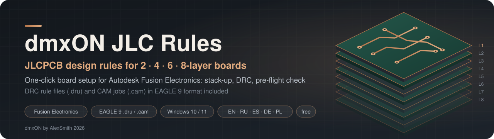

<p align="center">
  
</p>

<p align="center">
  <a href="https://github.com/AlexSmith2025/dmxON-JLC-Rules-Fusion-Electronics/releases/latest"></a>
  <a href="https://github.com/AlexSmith2025/dmxON-JLC-Rules-Fusion-Electronics/releases"></a>
  
  
  <a href="https://www.paypal.com/donate/?business=smith.show2025%40gmail.com&no_recurring=0&item_name=dmxON+JLC+Rules&currency_code=EUR"></a>
</p>

<p align="center">
  <a href="https://github.com/AlexSmith2025/dmxON-JLC-Rules-Fusion-Electronics/releases/latest/download/dmxON-JLC-Rules.zip"></a>
</p>

<p align="center">
  <a href="README.md">English</a> · <a href="README.ru.md">Русский</a> · <b>Español</b> · <a href="README.de.md">Deutsch</a> · <a href="README.pl.md">Polski</a>
</p>

<p align="center">
  <a href="#instalación">Instalación</a> ·
  <a href="#inicio-rápido">Inicio rápido</a> ·
  <a href="#compatibilidad">Compatibilidad</a> ·
  <a href="#perfiles">Perfiles</a> ·
  <a href="#archivos-de-reglas-sin-el-configurador">Archivos de reglas</a> ·
  <a href="#apoye-el-proyecto">Donar</a>
</p>

**Reglas de diseño (DRC) de JLCPCB para placas de 2, 4, 6 y 8 capas, trabajos CAM con los nombres de Gerber de JLCPCB y `dmxON_JLC_Setup.ulp` — la configuración de la placa en un clic para Autodesk Fusion Electronics (Fusion 360 Electronics): elige la pila de capas de JLCPCB adecuada, carga las reglas, revisa la placa y ejecuta el DRC.**

<p align="center">
  <a href="https://www.paypal.com/donate/?business=smith.show2025%40gmail.com&no_recurring=0&item_name=dmxON+JLC+Rules&currency_code=EUR"></a>
</p>

---

## Qué incluye

| | |
|---|---|
| 🧭 | **`dmxON_JLC_Setup.ulp`** — detecta las capas de la placa, crea las reglas de JLCPCB para su perfil, espesor y cobre, las carga, revisa la placa y muestra un resumen del DRC |
| 📏 | **12 archivos de reglas DRC** (`rules/*.dru`): 2, 4, 6, 8 capas × **Estándar**, **Denso**, **Extremo** |
| 🗂️ | **4 trabajos CAM** (`rules/*.cam`): Gerber RS-274X + Excellon con los nombres de archivo de JLCPCB (GTL, G1…, GBL, GTS, GBS, GTP, GBP, GTO, GBO, GKO, XLN) |
| 🧱 | **77 pilas de capas de JLCPCB** (4, 6, 8 capas · 0.8–2.0 mm · cobre de 1–2 oz) — espesores de prepreg y núcleo exactamente como en el pedido |
| 🛟 | **Copia de seguridad** de las reglas anteriores antes de cada ejecución y restauración con un botón |
| 🔎 | **Revisión previa** de lo que el DRC no ve: tamaño de la serigrafía, taladros no metalizados, tamaño de la placa, cobre fuera de la pila — con la lista de lo que está en la capa equivocada |
| 🌐 | **5 idiomas**: inglés, ruso, español, alemán y polaco — se elige en el diálogo; los archivos de reglas llevan su descripción en los cinco |

---

## Compatibilidad

| | Configurador `dmxON_JLC_Setup.ulp` | Archivos de reglas `.dru` | Trabajos CAM `.cam` |
|---|---|---|---|
| **Autodesk Fusion (Electronics), Windows 10/11** | ✅ probado en Fusion **2705.1.11** y **2705.1.30** (octubre de 2026) | ✅ probado | ✅ CAM Processor |
| Autodesk Fusion en macOS | ❌ usa comandos auxiliares de Windows | ✅ mismo formato | ✅ mismo formato |
| EAGLE 9.x | ❌ necesita los bucles ULP `polyPours`/`polyShapes` de Fusion | ✅ formato EAGLE 9 | ✅ formato de trabajo EAGLE 8.6–9.6 |
| KiCad, Altium, EasyEDA | ❌ | ❌ otro formato de reglas | ❌ |

Las versiones anteriores o posteriores de Fusion suelen funcionar también; si algo falla tras una actualización de Fusion, [abra un issue](https://github.com/AlexSmith2025/dmxON-JLC-Rules-Fusion-Electronics/issues). No hace falta conexión a internet ni software adicional.

---

## Instalación

1. [**Descargue `dmxON-JLC-Rules.zip`**](https://github.com/AlexSmith2025/dmxON-JLC-Rules-Fusion-Electronics/releases/latest/download/dmxON-JLC-Rules.zip) y descomprímalo donde quiera.
2. En Fusion Electronics: **Automation → Run ULP → `INSTALL.ulp`** desde la carpeta descomprimida, elija el idioma y pulse **Instalar**.
3. **Reinicie Fusion.** `dmxON_JLC_Setup` aparece en la lista **Run ULP** junto a los ULP integrados, y el paquete de reglas en **DRC → Load…** y en el CAM Processor; los archivos integrados de Fusion se mantienen.

El instalador copia el proyecto en `Documentos\dmxON\dmxON-JLC-Rules` y lo añade a las carpetas de ULP, reglas de diseño y CAM mediante los ajustes propios de Fusion. Ejecutar `INSTALL.ulp` de nuevo actualiza los archivos; **Quitar** devuelve a Fusion sus carpetas anteriores. Alternativa manual: mantenga la carpeta descomprimida completa (`dmxON_JLC_Setup.ulp` carga sus módulos de `lib\` a su lado) y ejecútelo con `RUN 'C:/ruta/dmxON_JLC_Setup.ulp'`.

---

## Inicio rápido

1. Abra la **placa** en Fusion Electronics.
2. Ejecute **Automation → Run ULP → `dmxON_JLC_Setup`**.
3. Elija el **idioma** en la esquina superior derecha (inglés por defecto) y compruebe el número de capas, el perfil y el espesor — la vista previa muestra todos los valores, la pila y las observaciones de la placa.
4. Pulse **Aplicar**. Unos segundos después aparece el resumen con el resultado del DRC.
5. **Guarde la placa** (Ctrl+S) — las reglas se guardan en ella y Fusion exporta el Gerber desde la versión guardada.

Lo mejor es ejecutarlo **antes de rutear** (así el ruteo sigue las reglas de JLCPCB desde el principio) y **otra vez antes de exportar**.

---

## El diálogo

| Campo | Qué ajusta |
|---|---|
| **Idioma** (arriba a la derecha) | English, Русский, Español, Deutsch, Polski — el diálogo cambia al instante; compartido con dmxON FabKit |
| **Capas de cobre** | 2, 4, 6 u 8. Por defecto: lo que indican la pila de la placa y el cobre de sus capas |
| **Perfil** | Estándar, Denso, Extremo — vea [Perfiles](#perfiles) |
| **Espesor, mm** | 0.4–2.0. JLCPCB fabrica 4–8 capas en 0.8–2.0 mm; si la opción no existe, se toma la más cercana con una nota |
| **Cobre exterior** | 1 oz (35 µm) o 2 oz (70 µm); 2 oz necesita pistas y separaciones más anchas |
| **Cobre interior** | 0.5, 1 o 2 oz — para 4–8 capas |
| **Color de máscara** | para la indicación del puente de máscara (0.10 mm; blanco y negro 0.13 mm) y para dmxON FabKit |
| **Vías cubiertas** | las vías de hasta 0.5 mm de taladro quedan cubiertas por la máscara (como «Tented» en la página del pedido) |
| **Panel V-cut** | cobre a 0.4 mm como mínimo del borde de la placa |
| **Clases de red no por debajo del mínimo** | sube las clases cuyo ancho, separación o taladro están por debajo del perfil; la clase 0 recibe el mínimo como valor de ruteo por defecto |
| **Paquete de reglas y CAM en Documentos/EAGLE** | los 12 archivos de reglas, el de su placa y el trabajo CAM van a `Documentos\EAGLE\design rules` y `\cam`; no se escribe nada en la carpeta del programa Fusion |
| **Espesor y máscara a dmxON FabKit** | [dmxON FabKit](https://github.com/AlexSmith2025/dmxON-FabKit-Fusion-Electronics) toma estos valores para el pedido |

Botones: **Aplicar** · **Solo archivos…** (escribe `.dru` y `.cam` para los ajustes elegidos en cualquier carpeta; la placa no se toca) · **Restaurar reglas anteriores** (tras una configuración previa) · **Cancelar**.

---

## Perfiles

Todas las medidas en milímetros, cobre de 1 oz.

| mm | 2 capas Estándar | 4–8 capas Estándar | 2 capas Denso | 4–8 capas Denso | 2 capas Extremo | 4–8 capas Extremo |
|---|---|---|---|---|---|---|
| Pista y separación | 0.127 | 0.127 | 0.10 | 0.10 | 0.10 | 0.09 ¹ |
| Pad a pad, redes distintas | 0.15 | 0.15 | 0.15 | 0.15 | 0.10 | 0.09 |
| Vía: taladro / diámetro | 0.3 / 0.45 | 0.3 / 0.45 | 0.3 / 0.40 | 0.3 / 0.40 | 0.15 / 0.25 ² | 0.15 / 0.25 ² |
| Anillo de vía, capas internas | — | 0.08 | — | 0.10 | — | 0.11 |
| Anillo PTH | 0.25 | 0.20 | 0.18 | 0.15 | 0.18 | 0.15 |
| Anillo PTH, capas internas | — | 0.20 | — | 0.20 | — | 0.21 |
| Taladro mínimo | 0.3 | 0.3 | 0.3 | 0.3 | 0.15 ² | 0.15 ² |
| Cobre al borde | 0.30 | 0.30 | 0.25 | 0.25 | 0.20 | 0.20 |
| Taladro a taladro | 0.25 | 0.25 | 0.20 | 0.20 | 0.20 | 0.20 |
| Expansión de la máscara | 0.05 | 0.05 | 0.05 | 0.05 | 0.05 | 0.05 |

¹ Las pistas de 3–3.5 mil en multicapa suman un **+20 %** al precio. ² Los taladros de menos de 0.3 mm tienen recargo — elija **Min via hole size** en la página del pedido.

- **Estándar** — la mayoría de las placas: margen tecnológico, sin recargos.
- **Denso** — diseños densos en el límite de lo que JLCPCB fabrica sin recargo.
- **Extremo** — BGA y paso fino; el mínimo absoluto de JLCPCB, algunos valores con recargo.

**Por qué el anillo interno es mayor:** en las capas internas JLCPCB exige 0.20 mm desde el taladro de una vía y 0.30 mm desde el taladro de un pin hasta el cobre ajeno; las reglas lo consiguen mediante el anillo, de modo que la separación normal no cambia.
**Cobre de 2 oz:** pista y separación 0.20 (Estándar), 0.16 en 2 capas / 0.15 en multicapa (Denso, Extremo); anillo PTH 0.26; puente de máscara desde 0.20.
**Separaciones de la misma señal** (`mdSmdPad`, `mdSmdVia`, `mdSmdSmd`) iguales a la separación entre señales distintas, para que Fusion no pregunte nada al cargar.

Valores por archivo: [rules/README.md](rules/README.md).

---

## Pila de capas y espesor

Las reglas incluyen la **pila de capas de JLCPCB** — capas de cobre, prepreg (`+`) y núcleo (`*`), espesores de cobre y dieléctrico. Fusion construye con ellas la pila física (Layer Stack Manager), así que el espesor en 3D y en el trabajo Gerber coincide con su pedido.

| Capas | 1.6 mm, 1 oz / 0.5 oz | Dieléctricos de arriba abajo, mm |
|---|---|---|
| 2 | `(1*16)` | núcleo 1.53 |
| 4 | `(1+2*15+16)` | prepreg 7628 0.2104 · núcleo 1.065 · prepreg 7628 0.2104 |
| 6 | `(1+2*3+14*15+16)` | 3313 0.0994 · núcleo 0.55 · 2116 0.1164 · núcleo 0.55 · 3313 0.0994 |
| 8 | `(1+2*3+4*13+14*15+16)` | 2116 0.1164 · núcleo 0.30 · 1080×2 0.1528 · núcleo 0.30 · 1080×2 0.1528 · núcleo 0.30 · 2116 0.1164 |

Las 77 pilas: [docs/STACKUPS.md](docs/STACKUPS.md). Las capas internas que ya tienen cobre conservan su número; si no, se usan los números habituales (4 capas: 2, 15 · 6 capas: 2, 3, 14, 15 · 8 capas: 2, 3, 4, 13, 14, 15).

---

## Revisión previa

| Comprobación | Por qué |
|---|---|
| Cobre en capas fuera de la pila elegida — con la lista de pistas, rellenos, vías, pads y piezas encontrados allí | desaparecería del Gerber |
| Sin contorno de placa (capa 20) | sin contorno no hay placa |
| Tamaño de la placa: de 3 × 3 mm a 670 × 600 (2 capas), 663 × 593 (4 capas), 656 × 586 mm (6–8 capas) | límites de JLCPCB |
| Pistas más finas y vías más pequeñas que el mínimo del perfil; vías de menos de 0.3 mm | previsión del DRC y recargo por taladros pequeños |
| Taladros no metalizados de menos de 0.5 mm | mínimo de JLCPCB |
| Textos de serigrafía de menos de 1.0 mm o con trazo de menos de 0.15 mm; líneas de menos de 0.15 mm | pueden quedar ilegibles o cortados |
| Clases de red por debajo del mínimo | el DRC y el ruteo las siguen |
| Mensajes de DRC aprobados en la placa | vea la nota más abajo |

---

## El resumen

Tras cargar las reglas, el configurador recalcula los polígonos (`RATSNEST`), ejecuta el DRC y muestra qué reglas se cargaron y dónde se guardaron las anteriores, qué clases de red se subieron, dónde se instaló el paquete, **errores de DRC por tipo** (separación, cobre al borde, distancia entre taladros, tamaño de taladro, sin rutear…) con advertencias y aprobaciones contadas aparte, e indicaciones como «los taladros de menos de 0.3 mm tienen recargo en JLCPCB». La lista de errores está en el panel **ERRORS** de Fusion.

---

## Restaurar las reglas anteriores

Antes de cada ejecución, las reglas actuales de la placa se guardan en `%LOCALAPPDATA%\dmxon_jlc\rules_backup`. Para recuperarlas, **ejecute de nuevo el configurador** y pulse **Restaurar reglas anteriores** — vuelven las reglas, la pila y las clases de red; después se recalculan los polígonos y se ejecuta el DRC.

> **Mensajes de DRC aprobados.** Una comprobación con reglas nuevas elimina las aprobaciones que ya no coinciden, y restaurar las reglas no las recupera. El configurador avisa si la placa tiene aprobaciones — guarde antes una versión de la placa (File → Save / Create Version).

---

## Modo por lotes

```
RUN dmxON_JLC_Setup.ulp -batch [-layers 2|4|6|8] [-profile Standard|Dense|Extreme] [-thick 1.6] [-outer 1|2] [-inner 0.5|1|2] [-mask Green] [-vcut] [-open] [-noclass] [-noinstall] [-nofabkit] [-lang en|ru|es|de|pl]
RUN dmxON_JLC_Setup.ulp -export <carpeta>
```

`-vcut` cobre a 0.4 mm del borde · `-open` vías sin cubrir · `-noclass` / `-noinstall` / `-nofabkit` omitir clases / paquete / FabKit · `-lang` idioma del resumen · `-export` solo escribe el paquete (12 `.dru` + 4 `.cam`), sin placa. Los ajustes del modo por lotes no se recuerdan.

---

## Archivos de reglas sin el configurador

**Reglas:** Fusion — **DRC → Load…** (o `DRC LOAD 'ruta/archivo.dru'`) y después **DRC**. EAGLE 9 — **Tools → DRC → File → Load…**.
**Trabajo CAM:** **Manufacturing → CAM Processor → Load job file** → `rules/dmxON_JLCPCB_<N>L.cam` → **Process Job**; comprima el resultado y súbalo a jlcpcb.com.
Los archivos de reglas suponen 1.6 mm, 1 oz / 0.5 oz, vías cubiertas y ruteo normal; para cualquier otra cosa use **Solo archivos…** en el configurador.

---

## Junto con dmxON FabKit

[**dmxON FabKit**](https://github.com/AlexSmith2025/dmxON-FabKit-Fusion-Electronics) convierte la placa en un pedido completo de JLCPCB: zip de Gerber, BOM y CPL con piezas LCSC, un informe, documentación A4 de montaje y hojas para transferencia de tóner.
Flujo: `dmxON_JLC_Setup` (reglas, pila, DRC limpio) → **guardar la placa** (Ctrl+S) → `dmxON_FabKit` (paquete del pedido; espesor y color de máscara ya rellenados).

> **Guarde la placa después de la configuración.** Fusion exporta el Gerber desde la última versión *guardada*; sin guardar, las reglas nuevas (anillos, vías, máscara) no llegan a los archivos Gerber.

---

## Preguntas y problemas

| Pregunta | Respuesta |
|---|---|
| `dmxON_JLC_Setup` no aparece en la lista Run ULP tras instalar | reinicie Fusion — lee su lista de carpetas al arrancar |
| Se detectó un número de capas incorrecto | el configurador lee la pila de la placa y el cobre de sus capas; elija el número correcto en la lista |
| «La capa N está fuera de la pila, pero contiene: …» | la observación enumera lo que hay en esa capa; quítelo de ella o elija más capas |
| Errores «Drill Size» | en Estándar y Denso, los taladros de menos de 0.3 mm son errores porque JLCPCB los cobra aparte; agrándelos o elija Extremo |
| Errores «Drill Clearance» | taladros más cercanos que la distancia del perfil (0.25 / 0.20 mm) |
| Muchos errores de «cobre al borde» | Estándar mantiene 0.3 mm (V-cut 0.4 mm); para una placa densa use Denso (0.25) o Extremo (0.2) |
| Los anillos de los pads crecieron | las reglas fijan el anillo mínimo de JLCPCB; un pad de biblioteca mayor se mantiene |
| ¿Dónde están los archivos? | reglas de la placa y copias — `%LOCALAPPDATA%\dmxon_jlc`; el paquete — `Documentos\EAGLE\design rules` y `\cam` |

---

## Cómo funciona

Paso 0 — `DRC SAVE` de las reglas actuales (copia y pila real) · paso 1 — análisis de la placa, diálogo, revisión previa, archivo de reglas · paso 2 — `DRC LOAD`, `CLASS`, `RATSNEST`, `DRC` · paso 3 — resumen del DRC. Detalles: [docs/ARCHITECTURE.md](docs/ARCHITECTURE.md) · cambios: [CHANGELOG.md](CHANGELOG.md).

```
dmxON-JLC-Rules/
├── dmxON_JLC_Setup.ulp     el configurador de la placa
├── INSTALL.ulp             añade el proyecto a las carpetas de ULP, reglas y CAM de Fusion
├── lib/                    jr_core (cadenas, archivos, idioma), jr_lang (textos es/de/pl), jr_rules (valores, .dru, .cam), jr_stack (77 pilas)
├── lang/                   strings.tsv — todos los textos de la interfaz en cinco idiomas
├── rules/                  12 .dru + 4 .cam + README
└── docs/                   ARCHITECTURE.md, STACKUPS.md, assets/
```

Fuentes: [capacidades de JLCPCB](https://jlcpcb.com/capabilities/pcb-capabilities) · [recargos](https://jlcpcb.com/help/article/In-what-cases-will-there-be-charged-extra) · [calculadora de impedancia / pilas](https://jlcpcb.com/impedance). Valores comprobados el 2026-10-09; JLCPCB cambia sus capacidades de vez en cuando — compruebe su página y el informe DFM antes de pedir.

---

## Apoye el proyecto

dmxON JLC Rules es **gratuito**. Detrás hay muchas tardes de pruebas en Fusion, estudio de las capacidades de JLCPCB y comprobación de cada pila hasta la micra. Si le evitó un pedido fallido, una tarde peleando con los ajustes del DRC o simplemente dinero, apoye el desarrollo: nuevas versiones, actualización de las reglas cuando JLCPCB cambie sus capacidades y correcciones para nuevas versiones de Fusion.

<p align="center">
  <a href="https://www.paypal.com/donate/?business=smith.show2025%40gmail.com&no_recurring=0&item_name=dmxON+JLC+Rules&currency_code=EUR"></a>
</p>

<p align="center">
  <b>PayPal:</b> <a href="https://www.paypal.com/donate/?business=smith.show2025%40gmail.com&no_recurring=0&item_name=dmxON+JLC+Rules&currency_code=EUR">smith.show2025@gmail.com</a> — cualquier cantidad ayuda. ¡Gracias! ⭐ Una estrella en GitHub también ayuda a que otros encuentren el proyecto.
</p>

---

## Licencia

Uso gratuito citando al autor; no se permite copiar el código, modificarlo ni usarlo comercialmente — vea [LICENSE.md](LICENSE.md). JLCPCB es una marca de su propietario; este proyecto no está vinculado a JLCPCB.

**dmxON by AlexSmith 2026** · [dmxon512.com](https://dmxon512.com) · proyecto hermano: [dmxON FabKit](https://github.com/AlexSmith2025/dmxON-FabKit-Fusion-Electronics)
